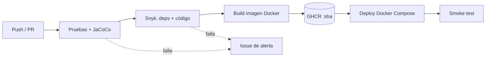

# ms-vehiculos — Pipeline CI/CD (DOY0101 · Evaluación Parcial 2)

Microservicio Spring Boot (Java 21, Maven, MySQL) con CRUD de vehículos y Swagger UI. Este repositorio automatiza su ciclo de vida completo con **GitHub Actions**, **Docker** y **Docker Compose** (con manifiestos **Kubernetes** adicionales).

**Integrantes:** _[Nombre 1]_ · _[Nombre 2]_

## 1. Arquitectura



Stack desplegado: contenedor `app` (Spring Boot, puerto 9004) + contenedor `db` (MySQL 8.4) en una red interna, con healthchecks y límites de CPU/memoria.

## 2. Contenedorización (IE1)
- `Dockerfile` **multi-stage**: etapa de build con JDK 21 (cache de dependencias por capas) y etapa final con JRE 21 Alpine, **usuario no root** y `MaxRAMPercentage` para respetar los límites del contenedor.
- `.dockerignore` para reducir el contexto de build.

## 3. Pipeline (`.github/workflows/ci-cd.yml`)
| Etapa | Qué hace | Indicador |
|---|---|---|
| `test` | `./mvnw verify`: JUnit 5 + Mockito (`VehiculoServiceTest`) y reporte JaCoCo como artefacto | IE2 |
| `security` | Snyk (dependencias) y Snyk Code con `--severity-threshold=high` | IE3 |
| `build-image` | Build con Buildx; push a GHCR solo desde `main` con tags `:<sha>` y `:latest` | IE1 |
| `deploy` | `docker compose up --wait` con la imagen del commit, smoke test HTTP y resumen | IE4 |
| `notify-failure` | Abre un issue automático si cualquier etapa falla | IE3 |

**Dependabot** (`.github/dependabot.yml`) revisa semanalmente Maven, Docker y GitHub Actions.

### Secretos requeridos
- `SNYK_TOKEN` (Settings → Secrets and variables → Actions). `GITHUB_TOKEN` lo provee GitHub.
- Entorno `produccion-simulada` (Settings → Environments), opcionalmente con aprobación manual.

## 4. Bloqueos y seguridad (IE3)
- Si Snyk encuentra vulnerabilidades *high/critical*, el job falla y **`build-image` y `deploy` no se ejecutan** (`needs`).
- Las credenciales de BD ya no están en el código: `application.yml` usa variables de entorno; en Compose se exigen por `.env` (ver `.env.example`) y en CI se generan aleatorias.
- Permisos mínimos por job (`permissions`), contenedor no root, versiones de dependencias parcheadas en `pom.xml`.
- Escalabilidad: límites de recursos en Compose; en Kubernetes, 2 réplicas + HPA (CPU 70 %, 2–5 pods).

## 5. Orquestación (IE5)
**Docker Compose** (`docker-compose.yml`): `app` depende de `db` con `condition: service_healthy`, red `backend`, volumen persistente `db-data`, `restart: unless-stopped`.

**Kubernetes** (`k8s/`): Deployment con probes de readiness/liveness, Service NodePort, HPA, MySQL con PVC y Secret.
```bash
kubectl apply -f k8s/secret.yaml -f k8s/mysql.yaml -f k8s/app.yaml
```
(Reemplazar `ghcr.io/OWNER/REPO:latest` por la imagen real.)

## 6. Trazabilidad y calidad (IE4)
- Cada imagen se etiqueta con el **SHA del commit** y labels OCI (`revision`, `source`): de la imagen en ejecución se llega al commit y al run.
- El resumen del job de deploy (`GITHUB_STEP_SUMMARY`) registra commit, imagen y enlace al run.
- Calidad: no se publica ni despliega nada sin pasar pruebas y análisis de seguridad; reportes de pruebas y cobertura quedan como artefactos de cada ejecución; el flujo con PR a `main` obliga a ejecutar el pipeline antes del merge.

## 7. Ejecución local
```bash
cp .env.example .env      # editar claves
docker compose up --build -d
# API: http://localhost:9004/  ·  Swagger: http://localhost:9004/swagger-ui.html
docker compose down -v
```
Pruebas: `./mvnw test`

## 8. Declaración de uso de IA
_[Completar: herramienta(s) usadas, para qué y cómo se validó el contenido. Citar según https://bibliotecas.duoc.cl/ia]_

## 9. Conclusiones
**Reflexión individual — _[Nombre 1]_:** _[Redactar personalmente, sin IA]_

**Reflexión individual — _[Nombre 2]_:** _[Redactar personalmente, sin IA]_
