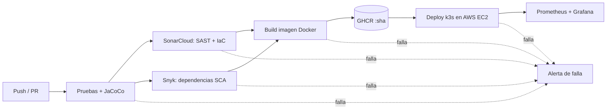
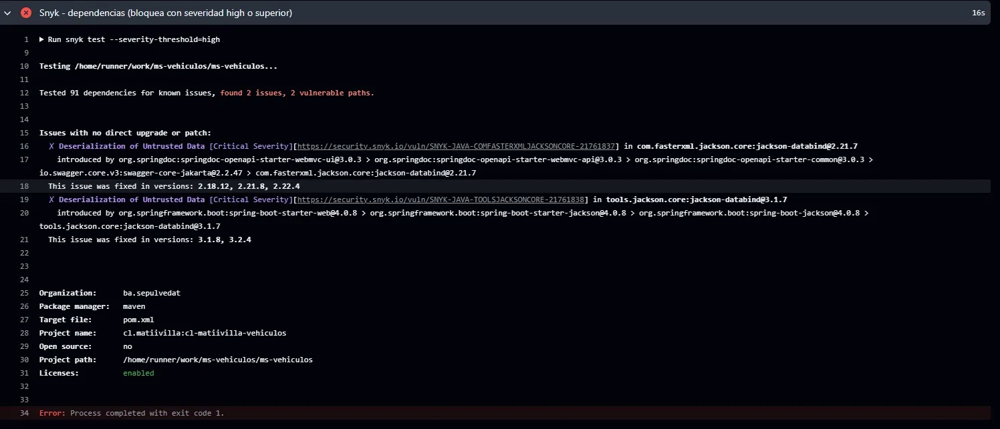
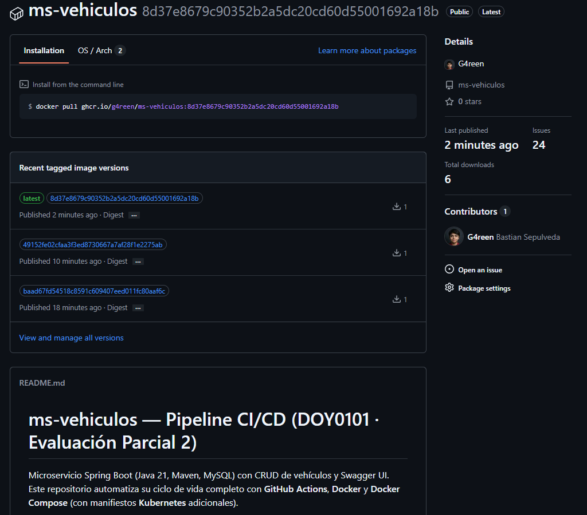

# ms-vehiculos — Pipeline DevSecOps, Kubernetes (AWS) y Observabilidad

**Asignatura:** DOY0101 Ingeniería DevOps · **Evaluación Parcial 3:** Orquestación en la nube, calidad de código y observabilidad
**Integrantes:** Bastian Sepulveda · Nicolas Bravo
**Repositorio:** https://github.com/G4reen/ms-vehiculos

Microservicio Spring Boot 4.0.10 (Java 21, Maven, MySQL 8.4) con CRUD de vehículos y Swagger UI. Este repositorio automatiza su ciclo de vida completo con **GitHub Actions**, **SonarCloud**, **Snyk**, **Docker (GHCR)** y despliegue continuo en un clúster **Kubernetes (`k3s`)** sobre **AWS EC2**, con monitoreo en tiempo real mediante **Prometheus** y **Grafana**.

## 1. Arquitectura del pipeline



Stack desplegado en AWS EC2 (`k3s`): 2 réplicas de `ms-vehiculos` (puerto interno `9004`, expuesto vía `NodePort 30004`) conectadas a `mysql` (MySQL 8.4.13 con almacenamiento persistente), junto con el stack de observabilidad `kube-prometheus-stack` (Prometheus en `30900` y Grafana en `30300`).

## 2. Contenedorización (IE1)
- `Dockerfile` **multi-stage**: etapa de build con JDK 21 (dependencias cacheadas por capas) y etapa final con JRE 21 Alpine, más liviana.
- Ejecución con **usuario no root** y `MaxRAMPercentage=75` para respetar los límites de memoria del contenedor.
- `.dockerignore` para reducir el contexto de build.

## 3. Pipeline (`.github/workflows/ci-cd.yml`)

| Etapa (job) | Qué hace | Indicador |
|---|---|---|
| `test` | `./mvnw verify`: pruebas unitarias JUnit 5 + Mockito (`VehiculoServiceTest`) y reporte de cobertura JaCoCo publicado como artefacto | IE2 |
| `sonarcloud` | Análisis estático de código Java y manifiestos IaC (`k8s/`, `Dockerfile`, Actions) con Quality Gate bloqueante (`-Dsonar.qualitygate.wait=true`) | IE3, IE4 |
| `security` | Snyk CLI: `snyk test` sobre dependencias Maven con `--severity-threshold=high` y excepciones documentadas en `.snyk` | IE3 |
| `build-image` | Build con Buildx; push a GHCR solo desde `main`, con tags `:<sha>` y `:latest` | IE1 |
| `deploy` | Copia manifiestos `k8s/` a la instancia EC2 vía SCP/SSH, actualiza la imagen del `Deployment` en `k3s` y verifica el rollout sin caída (`kubectl rollout status`) | IE4, IE5 |
| `notify-failure` | Notifica automáticamente si cualquier etapa del flujo falla | IE3 |

**Triggers:** push a `main` y `develop`, y pull requests hacia `main`. El push de la imagen y el despliegue en AWS ocurren solo en `main`.

**Dependabot** (`.github/dependabot.yml`) revisa semanalmente las dependencias de Maven, las imágenes Docker y las GitHub Actions.

### Configuración necesaria
- Secretos en GitHub (*Settings → Secrets and variables → Actions*): `SNYK_TOKEN`, `SONAR_TOKEN`, `EC2_HOST`, `EC2_USER` y `EC2_SSH_KEY`. `GITHUB_TOKEN` lo entrega GitHub automáticamente.
- Entorno `produccion-aws` (*Settings → Environments*).
- Workflow permissions en *Read and write* para publicar imágenes en GHCR.

## 4. Seguridad, calidad y bloqueos (IE3)
- **Bloqueos automáticos (Shift-Left):** Si SonarCloud no supera el *Quality Gate* o Snyk detecta vulnerabilidades de severidad **high o crítica**, los jobs posteriores (`build-image` y `deploy`) no se ejecutan gracias a las dependencias `needs`.
- **Casos reales resueltos durante el desarrollo:**
  1. Snyk detectó vulnerabilidades críticas de deserialización en Jackson (`jackson-databind`), deteniendo el build hasta actualizar las propiedades del `pom.xml` a las versiones parcheadas.
  2. SonarCloud bloqueó el *Quality Gate* por alertas de seguridad en infraestructura como código (IaC) y protocolos en texto claro en `k8s/app.yaml` y `ci-cd.yml`; se corrigieron fijando usuario sin privilegios (`UID/GID 10001`), volumen `/tmp` acotado (`sizeLimit: 100Mi`), `readOnlyRootFilesystem: true`, `automountServiceAccountToken: false` y el SHA completo en `actions/checkout`.
- **Gestión de secretos:** Las credenciales de MySQL no están en el código; se inyectan desde un `Secret` de Kubernetes (`vehiculos-db-secret`) hacia variables de entorno (`DB_USERNAME`, `DB_PASSWORD`).
- **Escalabilidad:** Límites de recursos por contenedor (`150m`–`1` CPU, `256Mi`–`512Mi` RAM, `256Mi`–`512Mi` almacenamiento efímero) y `HorizontalPodAutoscaler` (`ms-vehiculos-hpa`) entre 2 y 5 réplicas al superar el `70 %` de CPU.

## 5. Orquestación en AWS y Observabilidad (IE4, IE5)

**Kubernetes (`k3s` en AWS EC2, orquestación principal en producción):**
```bash
kubectl apply -f k8s/secret.yaml -f k8s/mysql.yaml -f k8s/app.yaml
```
- `k8s/app.yaml` define el `Deployment` (2 réplicas con `readinessProbe` y `livenessProbe` en `/actuator/health`), `Service` de tipo `NodePort` (`30004`), `HorizontalPodAutoscaler` y `ServiceMonitor` (`ms-vehiculos-monitor`) para scraping automático cada 15 segundos.
- `k8s/mysql.yaml` despliega MySQL 8.4 con `PersistentVolumeClaim` para persistencia de datos.

**Observabilidad (Prometheus + Grafana):**
- Spring Boot Actuator + Micrometer exponen métricas JVM, HTTP y del pool HikariCP en `/actuator/prometheus`.
- El dashboard **Observabilidad ms-vehiculos (AWS k3s)** en Grafana centraliza 6 paneles en vivo: Disponibilidad (`UP`), Errores HTTP 5xx (`0 req/s`), Tasa de Peticiones HTTP (`RPS`), Latencia de respuesta (`~2.7 ms`–`4.5 ms`), Memoria JVM Heap por pod (`33 MiB`–`52 MiB`) y Uso de CPU por pod.

## 6. Trazabilidad y calidad (IE4)
- **Trazabilidad:** Cada imagen se etiqueta en GHCR con el **SHA del commit** (`ghcr.io/g4reen/ms-vehiculos:<sha>`) y labels OCI (`revision`, `source`), y el resumen del job `deploy` (`GITHUB_STEP_SUMMARY`) registra el commit, la imagen desplegada y el nodo destino en AWS.
- **Calidad de código (SonarCloud + JaCoCo):** Cobertura de pruebas unitarias de **`82.3 %`**, **`0.0 %`** de duplicación, **Security Hotspots revisados al `100 %` (`A`)** y **Quality Gate `Passed`**.
- **Logs centralizados:** Salida estándar estructurada de Spring Boot accesible por réplica mediante `kubectl logs -l app=ms-vehiculos`.

## 7. Evidencias

**Pipeline completo en verde en GitHub Actions (pruebas → SonarCloud + Snyk → build GHCR → deploy en AWS k3s):**


**Calidad de código y cobertura en SonarCloud (Quality Gate Passed, 82.3 % de cobertura, 0.0 % duplicación):**


**Bloqueo por falla de seguridad: Snyk detecta vulnerabilidades críticas y detiene el pipeline:**



**Imagen publicada en GHCR, etiquetada con el SHA del commit:**



**Logs de arranque de Spring Boot 4.0.10 y conexión HikariCP a MySQL 8.4.13 en Kubernetes:**


**Prueba de carga concurrente con `curl` sobre el servicio expuesto en AWS (`NodePort 30004`):**


**Dashboard de observabilidad en tiempo real en Grafana (disponibilidad, RPS, latencia, JVM Heap y CPU por pod):**


## 8. Declaración de uso de Inteligencia Artificial

Se utilizó **Claude (Anthropic)** y **Gemini (Google)** como apoyo técnico para generar la base de los archivos `Dockerfile`, `docker-compose.yml`, `.github/workflows/ci-cd.yml`, `.github/dependabot.yml`, los manifiestos endurecidos de `k8s/`, el JSON del dashboard de Grafana y la estructura de este README, así como para orientar la depuración de errores del pipeline (reglas de seguridad IaC en SonarCloud, configuración de Snyk y despliegue SSH/SCP en `k3s`). Los integrantes ejecutaron el pipeline, revisaron y validaron el contenido generado, aplicaron las correcciones necesarias y probaron el resultado en GitHub Actions y AWS. Las conclusiones y reflexiones individuales fueron redactadas por los integrantes sin apoyo de IA.

_Referencia:_ https://bibliotecas.duoc.cl/ia

## 9. Conclusiones

## 9. Conclusiones

Reflexión individual — [Bastian Sepulveda]: Llevar este proyecto desde un pipeline básico hasta un despliegue automatizado en Kubernetes sobre AWS me permitió comprender cómo se integra la seguridad y la calidad en cada etapa de entrega. El mayor aprendizaje estuvo en resolver los bloqueos reales que surgieron en el camino: ajustar los manifiestos de Kubernetes y el workflow de GitHub Actions para cumplir con las reglas de seguridad de SonarCloud (como el uso de usuarios sin privilegios, sistema de archivos de solo lectura y volúmenes acotados) y lograr que el despliegue continuo hacia k3s funcionara sin caídas. Encargarme de conectar la automatización, la gestión de secretos, el clúster en la nube y la recolección de métricas me dio una visión mucho más concreta de cómo opera un entorno DevSecOps en producción.

Reflexión individual — [Nicolas Bravo]: Participar en esta etapa del proyecto me ayudó a valorar la importancia de contar con métricas reales y controles automatizados antes y después de desplegar un servicio. Mi enfoque estuvo en revisar los reportes de calidad y cobertura en SonarCloud, validar la ejecución de las pruebas unitarias con JaCoCo y comprobar el comportamiento del microservicio bajo carga mediante peticiones concurrentes hacia AWS. Observar en tiempo real en Grafana cómo respondían ambos pods en consumo de CPU, memoria JVM y latencia me permitió entender de forma práctica cómo la observabilidad cierra el ciclo de vida de un microservicio y facilita detectar problemas antes de que afecten a los usuarios.