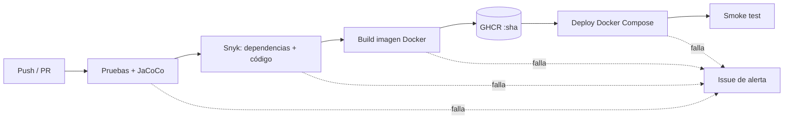
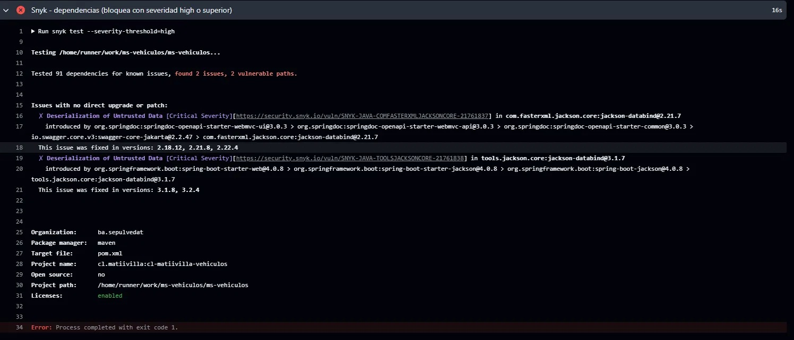
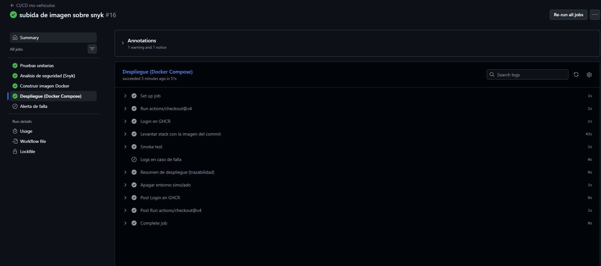
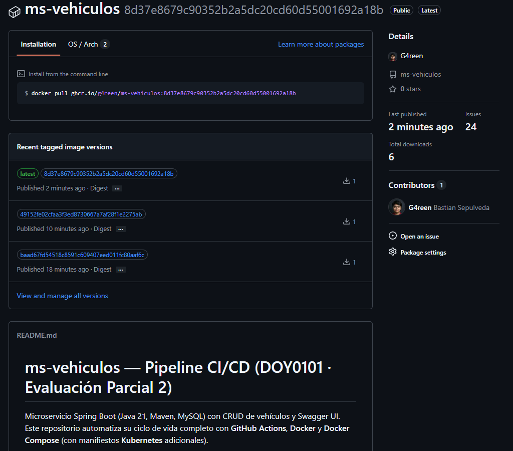

# ms-vehiculos — Pipeline CI/CD

**Asignatura:** DOY0101 Ingeniería DevOps · **Evaluación Parcial 2:** Añadiéndole complejidad a nuestro pipeline
**Integrantes:** _[Nombre 1]_ · _[Nombre 2]_
**Repositorio:** https://github.com/G4reen/ms-vehiculos

Microservicio Spring Boot (Java 21, Maven, MySQL) con CRUD de vehículos y Swagger UI. Este repositorio automatiza su ciclo de vida completo con **GitHub Actions**, **Docker** y **Docker Compose**, e incluye manifiestos **Kubernetes** de apoyo.

## 1. Arquitectura del pipeline



Stack desplegado: contenedor `app` (Spring Boot, puerto 9004) y contenedor `db` (MySQL 8.4) en una red interna, con healthchecks y límites de CPU y memoria.

## 2. Contenedorización (IE1)
- `Dockerfile` **multi-stage**: etapa de build con JDK 21 (dependencias cacheadas por capas) y etapa final con JRE 21 Alpine, más liviana.
- Ejecución con **usuario no root** y `MaxRAMPercentage=75` para respetar los límites de memoria del contenedor.
- `.dockerignore` para reducir el contexto de build.

## 3. Pipeline (`.github/workflows/ci-cd.yml`)

| Etapa (job) | Qué hace | Indicador |
|---|---|---|
| `test` | `./mvnw verify`: pruebas unitarias JUnit 5 + Mockito (`VehiculoServiceTest`) y reporte de cobertura JaCoCo publicado como artefacto | IE2 |
| `security` | Snyk CLI: `snyk test` (dependencias) y `snyk code test` (análisis estático), con `--severity-threshold=high` | IE3 |
| `build-image` | Build con Buildx; push a GHCR solo desde `main`, con tags `:<sha>` y `:latest` | IE1 |
| `deploy` | Levanta el stack con Docker Compose usando la imagen del commit, ejecuta smoke test HTTP y escribe un resumen del despliegue | IE4, IE5 |
| `notify-failure` | Abre automáticamente un issue si cualquier etapa falla | IE3 |

**Triggers:** push a `main` y `develop`, y pull requests hacia `main`. El push de la imagen y el despliegue ocurren solo en `main`.

**Dependabot** (`.github/dependabot.yml`) revisa semanalmente las dependencias de Maven, las imágenes Docker y las GitHub Actions.

### Configuración necesaria
- Secreto `SNYK_TOKEN` (Settings → Secrets and variables → Actions). `GITHUB_TOKEN` lo entrega GitHub automáticamente.
- Entorno `produccion-simulada` (Settings → Environments).
- Workflow permissions en *Read and write* para publicar en GHCR y crear issues.

## 4. Seguridad y bloqueos (IE3)
- Si Snyk detecta vulnerabilidades de severidad **high o crítica**, el job `security` falla y **`build-image` y `deploy` no se ejecutan** (dependencia `needs`). Además, `notify-failure` abre un issue de alerta.
- **Caso real durante el desarrollo:** Snyk detectó dos vulnerabilidades críticas de deserialización en Jackson (`jackson-databind` 2.21.7 y 3.1.7). El pipeline se bloqueó, y se corrigió actualizando las propiedades del `pom.xml` a las versiones parcheadas 2.21.8 y 3.1.8. Ver evidencia en la sección 7.
- Las credenciales de base de datos **no están en el código**: `application.yml` lee variables de entorno. En CI se generan claves aleatorias por despliegue dentro de un `.env` temporal del runner, y el `.env` está en `.gitignore`.
- Permisos mínimos por job (`permissions`), contenedor sin privilegios de root y versiones de dependencias parcheadas.
- **Escalabilidad:** límites de CPU y memoria por servicio en Compose; en Kubernetes, 2 réplicas más un HPA (CPU 70 %, entre 2 y 5 pods).

## 5. Orquestación (IE5)
**Docker Compose** (`docker-compose.yml`, orquestación principal usada en el despliegue):
- `app` depende de `db` con `condition: service_healthy`.
- Red interna `backend`, volumen persistente `db-data` y `restart: unless-stopped`.
- Healthchecks en ambos servicios y límites de recursos.

**Kubernetes** (`k8s/`, manifiestos de apoyo): Deployment con probes de readiness y liveness, Service NodePort, HPA, MySQL con PVC y Secret.
```bash
kubectl apply -f k8s/secret.yaml -f k8s/mysql.yaml -f k8s/app.yaml
```
_Nota: reemplazar `ghcr.io/OWNER/REPO:latest` en `k8s/app.yaml` por la imagen real. Estos manifiestos no se ejecutan en el pipeline._

## 6. Trazabilidad y calidad (IE4)
- **Trazabilidad:** cada imagen se etiqueta con el **SHA del commit** y con labels OCI (`revision`, `source`). Desde la imagen en ejecución se puede llegar al commit y al run que la generó.
- El resumen del job `deploy` (`GITHUB_STEP_SUMMARY`) registra commit, imagen y enlace al run.
- **Calidad:** no se publica ni despliega nada sin pasar antes pruebas y análisis de seguridad. Los reportes de pruebas y cobertura quedan como artefactos de cada ejecución, y los pull requests a `main` ejecutan el pipeline antes de integrarse.

## 7. Evidencias

**Pipeline completo en verde (pruebas → seguridad → build → deploy):**


**Bloqueo por falla de seguridad: Snyk detecta vulnerabilidades críticas y el pipeline se detiene:**



**Resumen del despliegue (commit, imagen y enlace al run):**



**Imagen publicada en GHCR, etiquetada con el SHA del commit:**



## 8. Declaración de uso de Inteligencia Artificial
_Texto base: ajustar a lo que realmente hicieron y citar según https://bibliotecas.duoc.cl/ia_

Se utilizó **Claude (Anthropic)** como apoyo técnico para generar la base de los archivos `Dockerfile`, `docker-compose.yml`, `.github/workflows/ci-cd.yml`, `.github/dependabot.yml`, los manifiestos de `k8s/` y la estructura de este README, y para orientar la depuración de errores del pipeline (configuración de Snyk, variables de entorno en el despliegue). Los integrantes ejecutaron el pipeline, revisaron y validaron el contenido generado, aplicaron las correcciones necesarias y probaron el resultado en GitHub Actions. Las conclusiones y reflexiones individuales fueron redactadas por los integrantes sin apoyo de IA.

_Referencia:_ _[Completar con la cita en el formato indicado por la biblioteca Duoc UC]_

## 9. Conclusiones

Reflexión individual — [Bastian Sepulveda]: Trabajar en este proyecto me dio una visión mucho más práctica de lo que realmente implica armar un pipeline de CI/CD funcional. Lo más valioso fue enfrentarme a los problemas reales durante la integración: por ejemplo, cuando Snyk nos detuvo el build por las vulnerabilidades críticas en Jackson, tuve que revisar los reportes, ajustar el pom.xml a las versiones parcheadas y volver a correr el flujo hasta dejarlo en verde. También fue un desafío configurar Docker Compose y los archivos de Kubernetes para que la app y la base de datos se comunicaran bien sin exponer credenciales en el código. Me encargué del desarrollo completo de la automatización, los archivos de despliegue y la resolución de errores en GitHub Actions, lo que me sirvió para entender cómo conectar todas las piezas de un stack DevOps real.


Reflexión individual — [Nicolas Bravo]: Participar en este proyecto me ayudó a entender la importancia de la automatización y el control de calidad en el ciclo de vida del software. Mi enfoque principal estuvo en colaborar con la revisión de los reportes del pipeline, la verificación de las pruebas con JaCoCo y la validación de que los manifiestos de Kubernetes y Docker funcionaran correctamente bajo los parámetros establecidos. Enfrentarnos a errores de configuración y resolverlos en equipo me permitió ver de cerca cómo los flujos de integración continua evitan que lleguen fallos a producción y facilitan el trabajo diario en desarrollo.